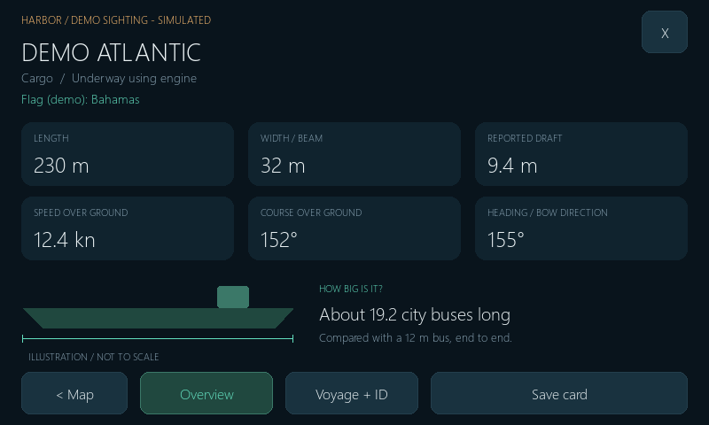

# Harbor — local boat tracker

A PyGame desktop prototype for a Raspberry Pi touchscreen, with a bundled offline coastline. It opens in **demo mode** by default, with six clearly labeled simulated vessels. The public example uses a generic South Florida area:

| Edge | Coordinate |
| --- | ---: |
| West | -80.16 |
| South | 26.0 |
| East | -79.7 |
| North | 26.25 |

The outlined rectangle is the subscribed area. The crosshair and nautical-mile rings are centered on that area, not on a GPS receiver. Copy `config.example.json` to `config.json` to customize the area locally. Personal configuration is ignored by Git; fresh checkouts use the example automatically.



## Vessel details and sighting cards

Select a boat, then tap **Vessel details >**. Large touch controls switch between:

- **Overview:** vessel type, navigation status, inferred flag country, length, width/beam, draft, speed, course, and heading. A size comparison uses a 12 m city bus as an explicit reference; the boat silhouette is an illustration, not the actual vessel.
- **Voyage + ID:** reported destination, ETA in UTC, call sign, IMO number, MMSI, AIS class, last position, and receipt ages for position/identity/voyage messages.
- **Save card:** saves both pages as one 800 × 960 PNG under `captures/`. Files include a UTC capture timestamp, report ages, AISstream attribution, and clear demo labelling. Nothing is uploaded. Copy the PNG to your phone or PC to share it.

Flag country is inferred from ordinary ship MMSIs using the bundled ITU MID table (292 assignments retrieved October 27, 2026). This is not independently verified flag registration. Special identifiers and unallocated MIDs show Unknown. Demo countries are explicitly fictional fixtures and never inferred from demo identifiers.

Static details can take minutes to arrive. Class B vessels do not normally provide the Class A voyage fields or navigation status. Unknown values are displayed as unknown, not as zeros. Explicit unavailable values clear older values; fields absent from partial messages preserve earlier information. AIS ETA contains no year, so the app shows the reported month/day/time in UTC without inventing a year or arrival countdown. Voyage receipt age does not prove crew-entered details are current. Upper-limit dimension and draft values display a lower-bound marker. Invalid IMO checksums are not displayed as valid identifiers.

All these details use the existing WebSocket subscription. No new runtime dependency or external vessel-lookup API is required.

## Start locally

On Windows, double-click **launch-demo.cmd** after installing the dependencies below.

For a fresh checkout, use Python **3.10 or newer**. In the project directory:

```powershell
python -m venv .venv
.\.venv\Scripts\python.exe -m pip install -r requirements.txt
.\.venv\Scripts\python.exe main.py --demo
```

On Linux, use `.venv/bin/python` in place of `.venv\Scripts\python.exe`. The package is **pygame-ce**, which provides the standard `pygame` import; do not install pygame and pygame-ce into the same environment.

## Connect AISstream

On Windows, double-click **launch-live.cmd**. The launcher uses `AISSTREAM_API_KEY` if set, otherwise it reads an optional Windows DPAPI-encrypted key from the ignored `.local/aisstream-key.dpapi` file or prompts for a key. It restores the previous environment on exit. Encrypted credentials are tied to their Windows account/machine and must stay local. Use **launch-live.cmd -Fullscreen** for fullscreen mode.

Create an API key in your [AISstream account](https://aisstream.io/account), then set it in your **local terminal**. The Python application reads the environment variable; it does not read a .env file or save the key. The optional Windows launcher supplies the key from the encrypted local credential.

PowerShell, using your project virtual environment:

```powershell
$env:AISSTREAM_API_KEY = "your-key"
.\.venv\Scripts\python.exe main.py --live
```

Linux:

```bash
export AISSTREAM_API_KEY="your-key"
.venv/bin/python main.py --live --fullscreen
```

No API key is embedded in source code. Live mode exits with a clear error if the key is missing; it never substitutes simulated vessels. Demo mode does not open a network connection, even if a key is set.

The client follows [AISstream's documentation](https://aisstream.io/documentation): WSS, per-message deflate compression, an immediate complete subscription, binary UTF-8 JSON frames, and exponential reconnect backoff with jitter. It requests Class A positions, standard and extended Class B positions, and static vessel reports. Field names were checked against the [official message schema](https://github.com/aisstream/ais-message-models/blob/master/type-definition.yaml).

Your longitude/latitude bounds are converted to AISstream's **latitude/longitude** corner order:

```json
"BoundingBoxes": [[[26.0, -80.16], [26.25, -79.7]]]
```

Subscription rejection stops retries and shows a message to check the key and account limits. Network disconnects reconnect automatically. An empty view may mean no recent reports in this small area; AISstream is event-driven and does not provide a guaranteed complete inventory of boats.

## Controls

- Tap a vessel marker for its name, MMSI, type, speed, course, coordinates, and position age.
- Tap a vessel row to select it and center the view on it.
- Drag the position view to pan.
- Tap **+ / −** to zoom; mouse wheel also works.
- Tap **Home** to restore the configured center and range.
- Tap **Trails** to show or hide recent reported positions.
- Use **< / >** above the vessel list to page through all targets.
- Tap **X**, or press **Esc / Q**, to exit. Keyboard shortcuts: **H** for home, **T** for trails, **+ / −** for zoom.
- In vessel details, **X**, **Esc / Q**, or **< Map** returns to the map. Map pan/zoom controls are disabled while a profile is open. If a vessel expires, the details view offers a return to the map rather than silently switching to another boat.

Touch input and mouse input share the same controls. Synthetic mouse events from touchscreen input are ignored to prevent double taps. The 800 × 480 canvas scales and letterboxes when the window is resized.

## Display and performance settings

Copy `config.example.json` to `config.json`, then edit the local copy for the area name, bounds, display dimensions, frame rate, stale/expiry ages, vessel cap, and trail length. Restart to apply configuration changes. Do not commit personal configuration, credentials, or live vessel captures. Tests and published previews always use the example configuration.

The default is an **800 × 480** window at **20 FPS**. Network I/O runs on a separate thread. The incoming queue, vessel store, trails, and rendered-text cache have limits. The 54 KB regional land layer is cached until the view changes. No browser, map tile requests, GPU effects, or database is required.

Positions turn muted after 3 minutes without a new position report and expire after 15 minutes. Static name/type messages do not refresh an old position. Ages are based on local receipt time, not a claim about when a remote receiver observed the vessel. An AIS unavailable speed/course/heading is shown as unknown.

Panning and zooming change only the view, never the subscription. Targets outside the configured bounds are excluded. The projection is intended for this small local area; bounds crossing the antimeridian or near the poles are unsupported.

## Validation

The vessel-details update passed **24 tests on October 27, 2026** on Windows with Python 3.14.2, pygame-ce 2.5.8 and websockets 17.3. Tests include actual local WebSocket delivery/reconnection, Class A/B field merging, sentinel values, ETA calendar validation, IMO checksums, MMSI inference, touch navigation, expiration, and two-page PNG export. Demo, Class B, missing-data, stale-data and 1280 × 800 letterboxed previews are in `previews/`. This update has not yet been run on the physical Pi.

Regenerate previews with `.venv\Scripts\python.exe tools\render_previews.py`.

Run:

```powershell
.\.venv\Scripts\python.exe -m unittest discover -s tests -v
.\.venv\Scripts\python.exe main.py --demo --headless --frames 3 --screenshot preview.png
```

Tests cover coordinate order, Class A/B parsing, invalid/unavailable AIS fields, static-data merging, aging, bounded memory, a real local binary WebSocket stream, reconnects, rejected subscriptions, touch de-duplication, pan/home/selection/pagination, letterboxing, and land/water alignment through pan and zoom.

Validated locally with Windows, Python 3.14.2, pygame-ce 2.5.8 and websockets 17.3. Live AISstream authentication and compressed subscription have been verified. Raspberry Pi/display performance remains untested. The checked-in previews contain simulated vessels only.

## Prototype scope

The position plot includes a **simplified offline land/coastline layer** from Natural Earth. Land and boats share the same geographic projection, and the scale bar shows nautical miles. The map is intended for a rough visual sense of how far offshore a vessel is. It does not show detailed harbor entrances, channels, depths, or navigation aids. Demo tracks are simulated and wrap around the demo area. This is not a navigation chart.

The target hardware is a Raspberry Pi Zero W running Raspberry Pi OS Bookworm with an HDMI/USB touchscreen. Application performance on that ARMv6 device remains to be measured. A network connection is required for AISstream.

## Update the existing Pi installation

The commands below assume an installation at `~/Documents/boat-tracker`; adjust it for your device. Close the running tracker first. The archive updates runtime code, the example configuration, bundled data, tests and documentation; it leaves `config.json`, `.venv`, the saved API key and the touchscreen launcher intact.

Build the update archive from a Windows checkout:

```powershell
.venv\Scripts\python.exe tools\package_update.py
scp .\boat-tracker-update.zip YOUR_USER@YOUR_PI_HOST:~/Documents/boat-tracker/
```

Then, in an SSH terminal on the Pi:

```bash
cd ~/Documents/boat-tracker
.venv/bin/python -m zipfile -e boat-tracker-update.zip .
```

Restart the app using your usual launcher. Tap a boat, then **Vessel details >**.


## Offline land map

The bundled data/south-florida-land.json contains simplified land polygons and shoreline lines from [Natural Earth 1:10m land](https://www.naturalearthdata.com/downloads/10m-physical-vectors/10m-land/), which is [public domain](https://www.naturalearthdata.com/about/terms-of-use/). Its extent is longitude -82 to -78.5 and latitude 24.5 to 28. No tiles, accounts, or extra runtime Python packages are needed.

The source is a generalized **1:10,000,000-scale** dataset; this is not 10-meter accuracy. Small islands and inlet details may be omitted or distorted. The map is clipped to South Florida and simplified at 0.0005 degrees; crop boundaries are excluded from the shoreline strokes. The JSON records its source URL and archive SHA-256.

The coastline does not change the AIS subscription box. The existing rings remain centered on the subscription area; use the separate scale bar to estimate distances. Panning beyond the regional dataset displays a coverage notice when the view center leaves its bounds.
